# JET LAB - Mobile Game Menu System (CS-464 Lab 07)

**Student:** Muhammad Abdullah | **Roll number:** BSCS25017

**Unity version:** Unity 6.3 LTS - 6000.3.24f1 | **Render pipeline:** URP | **Target:** Android, portrait, 1080 x 1920

**Demo video:** https://drive.google.com/file/d/1F92EiTBn7fmXJcsxC1NbICTV6w-MajVI/view?usp=drive_link

**Build:** https://github.com/m-abdullah-2007/ITU-CS-464-LAB-07-BSCS25017/releases/tag/v1.0.0

## 1. Game and design direction
JET LAB is a portrait mobile jetpack runner. It is **inspired by Jetpack Joyride** (Halfbrick Studios) for the genre and menu structure only. The title, palette, layout, shapes and all code are my own. No assets from the original game are used.

**Palette (my own):**
| Token | Hex | Role | Greyscale value |
|---|---|---|---|
| Deep Navy | #101D32 | background (60%) | 29 |
| Panel Navy | #1B2D4A | cards and secondary buttons (30%) | 45 |
| Soft White | #F3F5F7 | main text | 245 |
| Muted Blue | #9FB0C8 | captions | 174 |
| Electric Cyan | #25D9D0 | primary action, good state (10%) | 195 |
| Coral | #FF875C | danger / warning (10%) | 168 |
| Gold | #FFD166 | coins only | 215 |

**Colour rules:** text on cyan or coral is always Deep Navy (white on those fails contrast: 1.61 and 2.17). Measured contrast: White on Navy 15.45, Navy on Cyan 9.58, Navy on Coral 7.13, Muted on Panel 6.26. Meaning is never carried by hue alone: every state also has a word, a shape or a size difference.

**Assets:** only Unity built-ins (Cube, Sphere, Capsule, Cylinder, default UI sprites, TextMeshPro default font). No imported assets, no downloaded images, no AI-generated images.

**Motion:** all tweens are my own code (coroutines + easing functions in `Tween.cs`). No Animator, no animation clips, no tween packages. Ease curves used: OutCubic, OutQuad, InQuad, OutBack. All tweens use unscaled time so they work while the game is paused.

## 2. Screen flow
```
Main Menu -> Loadout -> HUD <-> Pause -> Confirm -> Main Menu
HUD -> Game Over -> Retry (HUD) / Shop / Menu
Main Menu -> How To Play | Settings | Shop | Missions (each has Back to Main Menu)
Main Menu -> Quit -> Confirm
```

## 3. Screens
### Screen 1 - Main Menu
**Purpose:** Entry point: one obvious action (PLAY), everything else within thumb reach.

**Principles and techniques used:**
- Visual hierarchy: 150 px cyan title, tallest/brightest button is PLAY
- 60-30-10 colour split (navy 60, panel 30, cyan/coral/gold 10)
- Grouping by proximity and similarity (3 secondary buttons share one style)
- Thumb-zone placement, buttons at least 170 px tall
- Responsive anchors: title top-centre, coins top-right, buttons bottom-centre; Canvas Scaler 1080x1920 at 0.5; safe area

**Tweens and ease curves:**

| Element | Tween | Duration | Ease | Why |
|---|---|---|---|---|
| Screen enter | fade + slide up 80 px | 0.3 s | OutQuad / OutCubic | a new screen arrived; soft landing |
| Title | scale 0.85 to 1 | 0.45 s | OutBack | brand moment, springy |
| Buttons | staggered pop-in | 0.4 s each | OutBack | order of arrival = order of importance |
| Button press | scale 1 to 0.94 and back | 0.08 s / 0.2 s | InQuad / OutBack | pressed feedback |

**Annotated colour screenshot** (arrows / boxes / callouts on the design decisions):

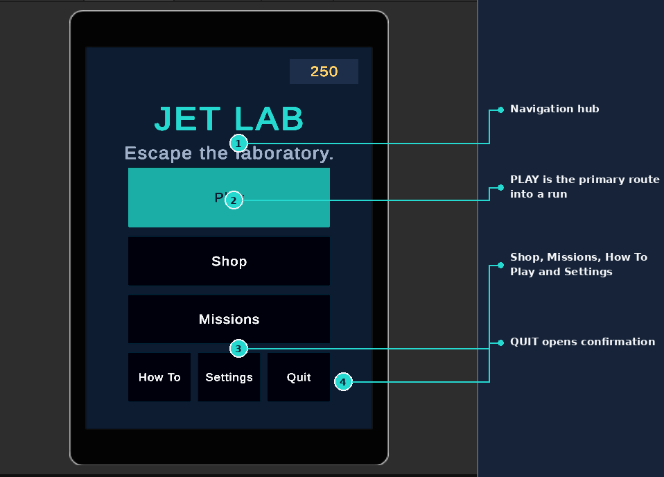

**Greyscale screenshot:**

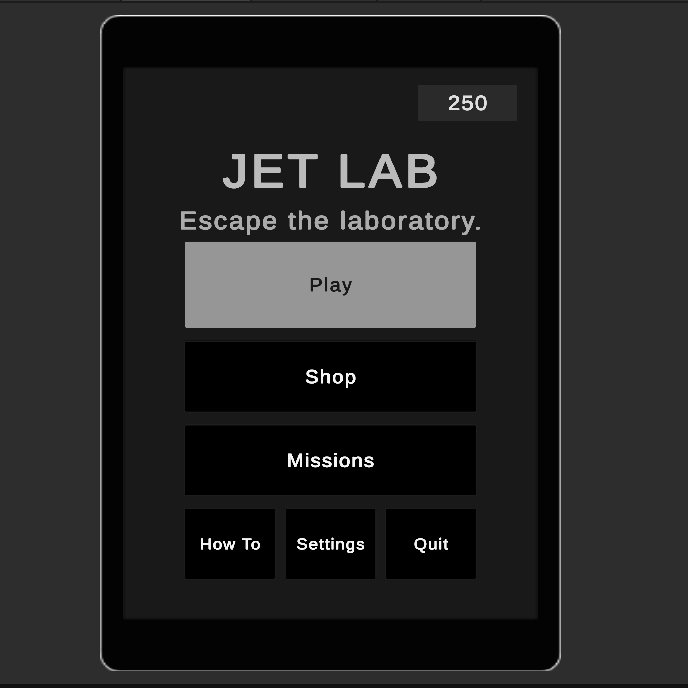

**Greyscale check:** The Prefabs were made in a way of buttons so that their use case like primary, secondary and Danger showcases their HSV demand.

---

### Screen 2 - Loadout / Character Preview
**Purpose:** Preview the pilot and jetpack (built from Unity primitives), choose a jetpack, start the run.

**Principles and techniques used:**
- Hero element (3D preview via Render Texture) is largest
- Grouping: arrows sit on the preview, stats in one card
- Disabled arrows when only one jetpack is owned (affordance)
- EQUIPPED / OWNED word as a second cue beyond colour
- Consistent Back button position

**Tweens and ease curves:**

| Element | Tween | Duration | Ease | Why |
|---|---|---|---|---|
| Screen enter | fade + slide up | 0.3 s | OutQuad / OutCubic | consistent entrance |
| Preview + card | staggered pop-in | 0.4 s | OutBack | hero first, details second |
| Preview and name on change | scale 1 to 1.06 / 1.12 and back | 0.08 s + 0.25 s | OutQuad then OutBack | confirms the change |

**Annotated colour screenshot** (arrows / boxes / callouts on the design decisions):

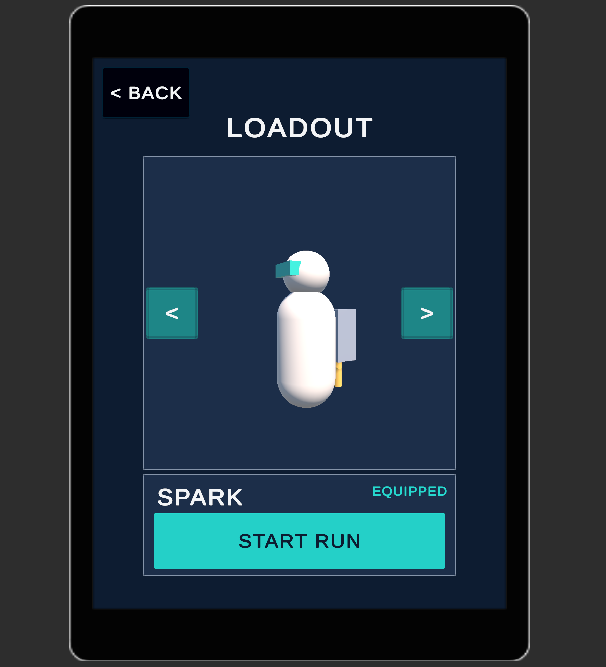

**Greyscale screenshot:**

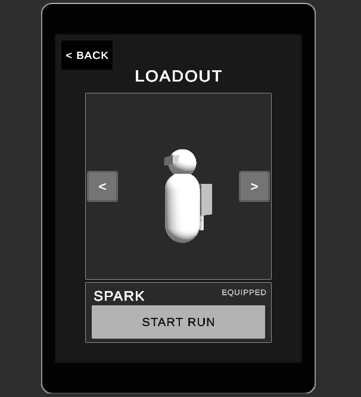

**Greyscale check:** The Prefabs were made in a way of buttons so that their use case like primary, secondary and Danger showcases their HSV demand.

---

### Screen 3 - How To Play
**Purpose:** Teach the three things a new player needs, in order.

**Principles and techniques used:**
- Numbered badges give reading order
- Common region: one card per step
- Alignment: badges share a left edge, titles share a left edge
- Two ways back (BACK and GOT IT), no dead end
- Muted text on panel contrast 6.26:1

**Tweens and ease curves:**

| Element | Tween | Duration | Ease | Why |
|---|---|---|---|---|
| Screen enter | fade + slide up | 0.3 s | OutQuad / OutCubic | consistent entrance |
| Step cards | staggered pop-in 0.15 s apart | 0.4 s | OutBack | motion teaches the order 1-2-3 |
| GOT IT | pops in last | 0.4 s | OutBack | action after information |

**Annotated colour screenshot** (arrows / boxes / callouts on the design decisions):

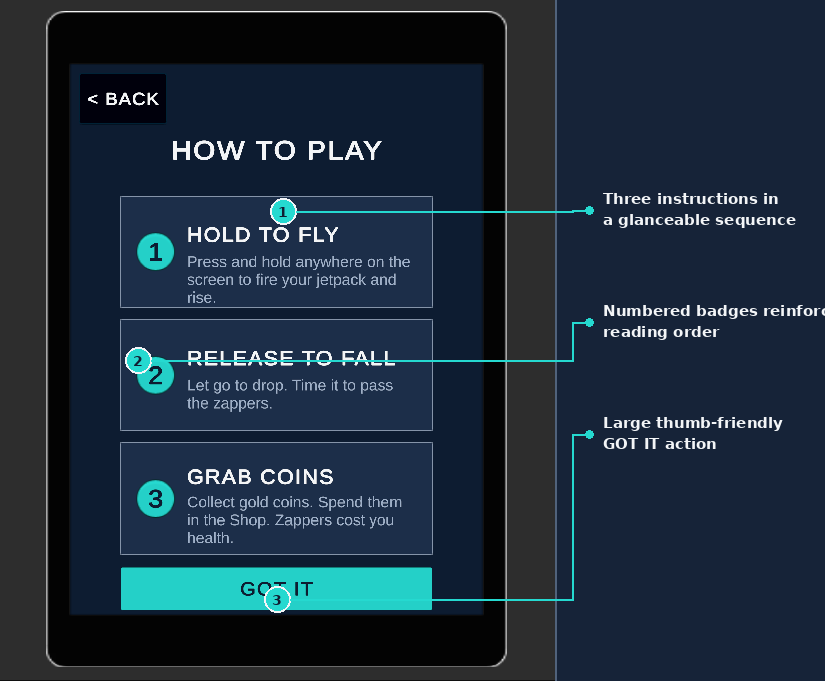

**Greyscale screenshot:**

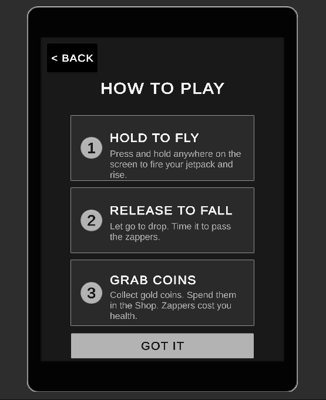

**Greyscale check:** The Prefabs were made in a way of buttons so that their use case like primary, secondary and Danger showcases their HSV demand.

---

### Screen 4 - Settings
**Purpose:** Change volume, haptics and left-handed HUD; changes apply immediately and are saved.

**Principles and techniques used:**
- Common region: one panel per setting, label left, control right
- Large slider handle (90 px) for touch
- ON/OFF is a word, not only a colour (colour-blind safe)
- Immediate feedback on every change
- Left-handed HUD uses anchors (responsive layout)

**Tweens and ease curves:**

| Element | Tween | Duration | Ease | Why |
|---|---|---|---|---|
| Screen enter | fade + slide up | 0.3 s | OutQuad / OutCubic | consistent entrance |
| Rows | staggered pop-in | 0.4 s | OutBack | reading order |
| ON/OFF word on toggle | scale 1 to 1.3 and back | 0.08 s + 0.25 s | OutQuad then OutBack | state changed |
| Slider | no tween (on purpose) | n/a | n/a | direct manipulation must be 1:1 |

**Annotated colour screenshot** (arrows / boxes / callouts on the design decisions):

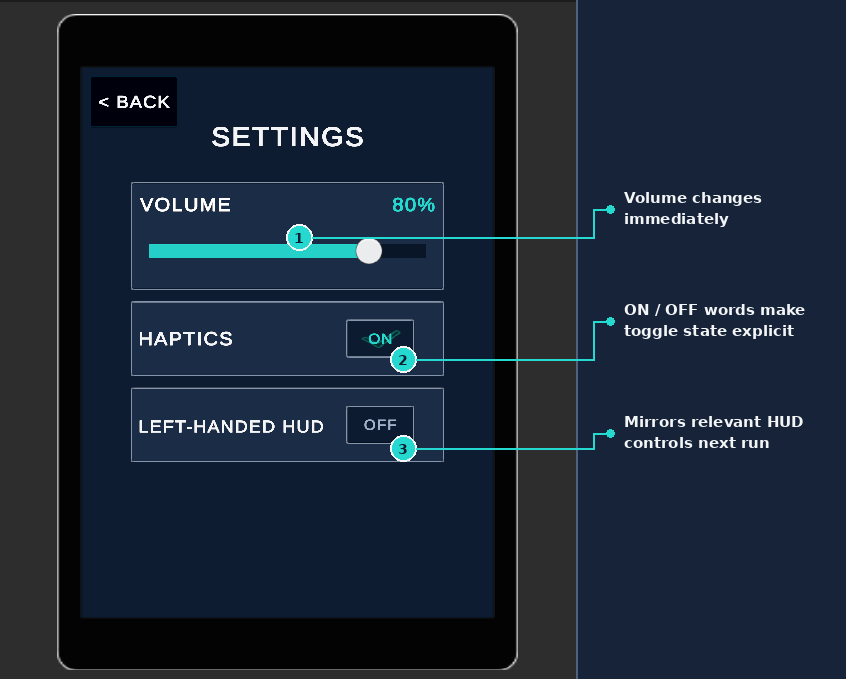

**Greyscale screenshot:**

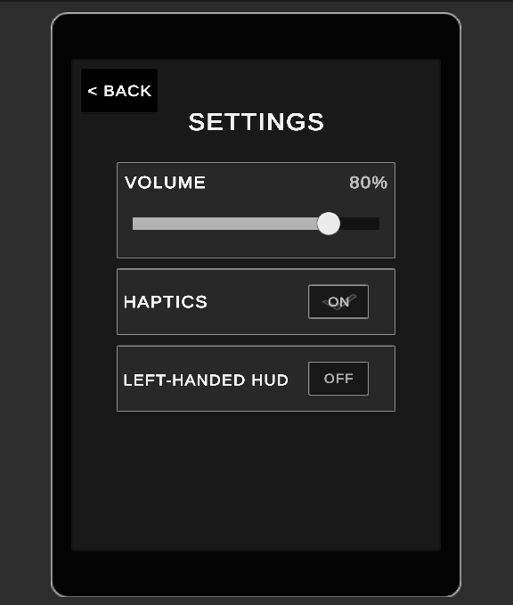

**Greyscale check:** The Prefabs were made in a way of buttons so that their use case like primary, secondary and Danger showcases their HSV demand.

---

### Screen 5 - Shop
**Purpose:** Buy jetpacks with coins; always show cost, affordability and ownership.

**Principles and techniques used:**
- Three states with three words: BUY, NEED n, OWNED
- Shape cue on swatches (square, rounded, circle) mirrors Cube, Cylinder, Sphere
- Gold = coins everywhere (consistent colour meaning)
- Similar cards, aligned swatches and buttons
- Touch targets 380 x 150 px

**Tweens and ease curves:**

| Element | Tween | Duration | Ease | Why |
|---|---|---|---|---|
| Screen enter | fade + slide up | 0.3 s | OutQuad / OutCubic | consistent entrance |
| Cards | staggered pop-in | 0.4 s | OutBack | three separate items in order |
| Coin number on purchase | counts down | 0.4 s | OutCubic | shows cause and effect |
| Button and message on purchase | scale pop | 0.08 s + 0.25 s | OutQuad then OutBack | reward feedback |

**Annotated colour screenshot** (arrows / boxes / callouts on the design decisions):

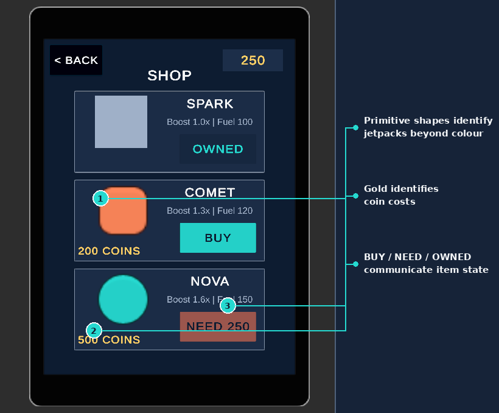

**Greyscale screenshot:**


**Greyscale check:** The Prefabs were made in a way of buttons so that their use case like primary, secondary and Danger showcases their HSV demand.

---

### Screen 6 - Missions
**Purpose:** Give goals and a reward loop; show progress at a glance.

**Principles and techniques used:**
- Progress bar plus number plus state word (IN PROGRESS / CLAIM / DONE)
- Only the claimable mission is bright cyan (hierarchy through colour)
- Grouping by card, alignment of titles and buttons
- Fixed integer-division bug with a float cast

**Tweens and ease curves:**

| Element | Tween | Duration | Ease | Why |
|---|---|---|---|---|
| Screen enter | fade + slide up | 0.3 s | OutQuad / OutCubic | consistent entrance |
| Cards | staggered pop-in | 0.4 s | OutBack | reading order |
| Progress bars | fill from empty to value | 0.6 s | OutCubic | motion shows how far along |
| Claim | button pop + coins count up | 0.25 s / 0.5 s | OutBack / OutCubic | reward feedback |

**Annotated colour screenshot** (arrows / boxes / callouts on the design decisions):

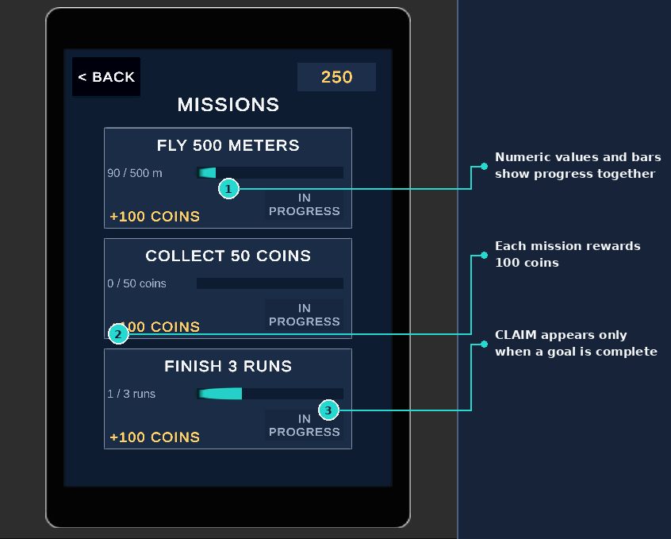

**Greyscale screenshot:**

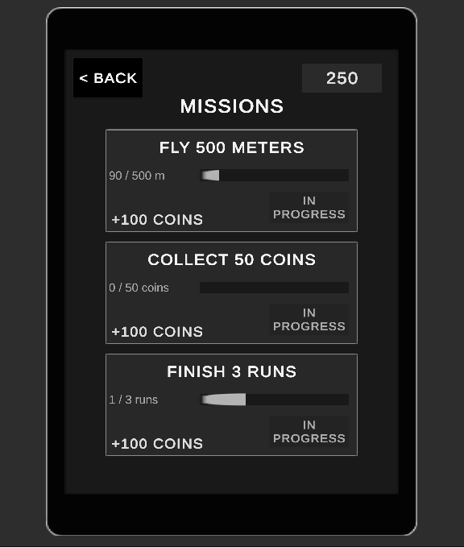

**Greyscale check:** The Prefabs were made in a way of buttons so that their use case like primary, secondary and Danger showcases their HSV demand.

---

### Screen 7 - Game HUD
**Purpose:** Show health, distance and coins at a glance while keeping the play area clear.

**Principles and techniques used:**
- Health in the top-left (first place the eye checks), distance largest text, coins gold
- Non-diegetic screen-space HUD
- Responsive anchors: top-left, top-centre, top-right; mirrored for left-handed mode
- Health shown as bar and number HP n/5; no red/green
- Pause is a 150 x 150 px corner target

**Tweens and ease curves:**

| Element | Tween | Duration | Ease | Why |
|---|---|---|---|---|
| HUD enter | fade + short slide | 0.25 s | OutQuad / OutCubic | short: player wants to play |
| Lag bar after hit | waits 0.4 s, slides down | 0.35 s | OutCubic | shows how much health was lost |
| Health group on hit | scale 1 to 1.1 and back | 0.08 s + 0.25 s | OutQuad then OutBack | draws eye to health |
| Coin counter on pickup | scale 1 to 1.15 and back | 0.08 s + 0.25 s | OutQuad then OutBack | acknowledges pickup |

**Annotated colour screenshot** (arrows / boxes / callouts on the design decisions):

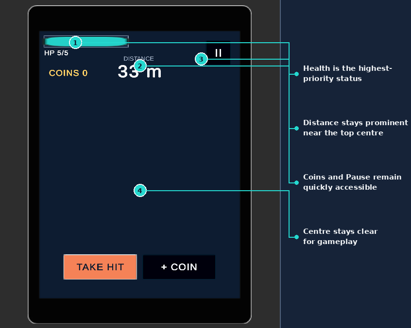

**Greyscale screenshot:**

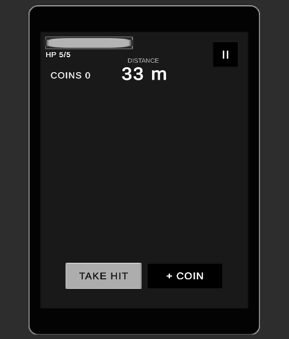

**Greyscale check:** The Prefabs were made in a way of buttons so that their use case like primary, secondary and Danger showcases their HSV demand. The Take Hit and the +Coins are just temp buttons for showcasing UI Changes and effects hence their HSVs were not that much thought upon.

---

### Screen 8 - Pause Menu
**Purpose:** Stop the run safely and offer Resume, Restart, Quit to menu.

**Principles and techniques used:**
- One cyan primary action (RESUME), two quieter buttons
- Common region: card on a dimmed layer; dim layer blocks input behind
- Time.timeScale = 0 and AudioListener.pause while open
- First button pre-selected for keyboard / gamepad
- Destructive QUIT goes through a confirm

**Tweens and ease curves:**

| Element | Tween | Duration | Ease | Why |
|---|---|---|---|---|
| Dim layer + card | fade in | 0.21 s | OutQuad | gentle state change |
| Card | scale 0.9 to 1 | 0.3 s | OutBack | pops in front of the game |
| Closing | no tween | n/a | n/a | player wants the game back now |
| All tweens use unscaled time | Time.unscaledDeltaTime | - | - | game is frozen while paused |

**Annotated colour screenshot** (arrows / boxes / callouts on the design decisions):

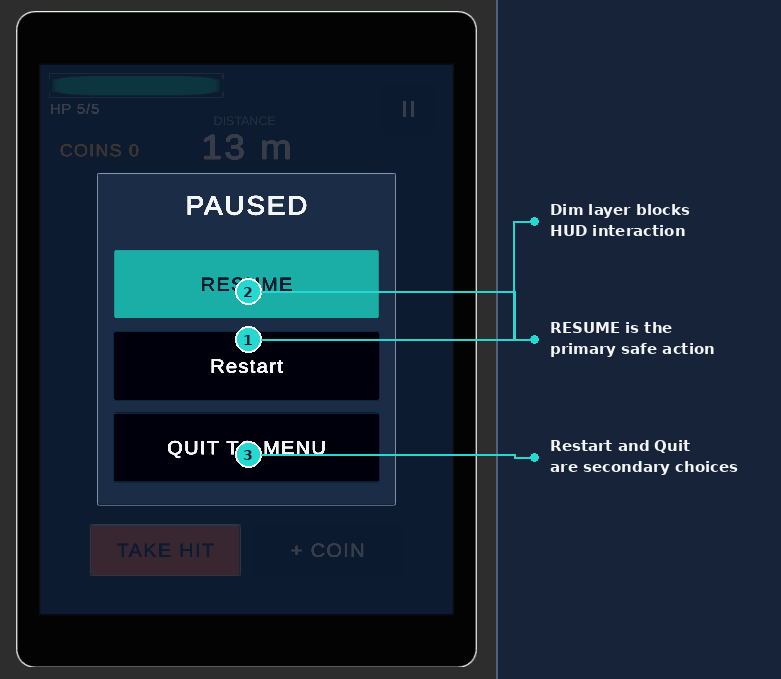

**Greyscale screenshot:**

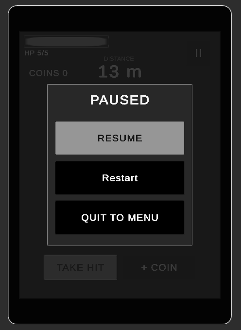

**Greyscale check:** The Prefabs were made in a way of buttons so that their use case like primary, secondary and Danger showcases their HSV demand. It was designed to blur the HUD Panel behind it so only the pause panel has more significance on the screen.
---

### Screen 9 - Game Over / Results
**Purpose:** Tell the player how the run went in two seconds and make the next step obvious.

**Principles and techniques used:**
- Distance is the largest number (160 px); best and coins quieter
- Coral heading is also the words RUN OVER; NEW BEST! is a word and a block
- RETRY is the largest, pre-selected button
- Three exits, no dead end
- Show only what is needed now

**Tweens and ease curves:**

| Element | Tween | Duration | Ease | Why |
|---|---|---|---|---|
| RUN OVER heading | scale 0.8 to 1 | 0.4 s | OutBack | firm stamp at the start |
| Distance and coins | count up from 0 | 0.9 s / 0.6 s | OutCubic | watch the run add up |
| NEW BEST! tag | pops in after the count | 0.5 s | OutBack | reward arrives last |
| Buttons | staggered pop-in | 0.4 s | OutBack | next step after results |

**Annotated colour screenshot** (arrows / boxes / callouts on the design decisions):

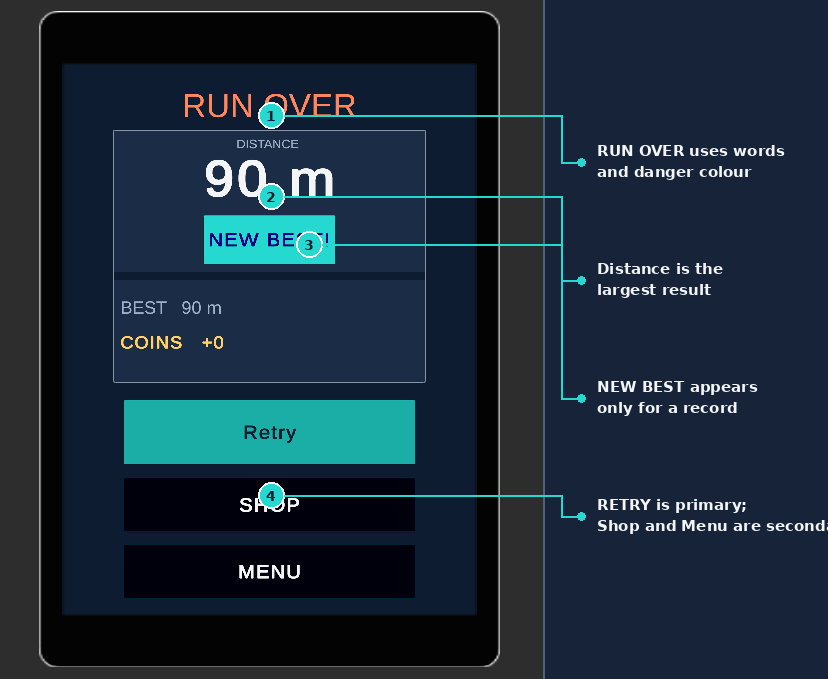

**Greyscale screenshot:**

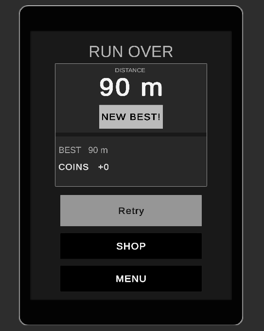

**Greyscale check:** The Prefabs were made in a way of buttons so that their use case like primary, secondary and Danger showcases their HSV demand.

---

### Screen 10 - Confirm (Exit / Leave Run)
**Purpose:** Protect the player from a destructive tap; one dialog for quitting the app and leaving a run.

**Principles and techniques used:**
- Safe choice (CANCEL) is big, cyan and pre-selected; destructive choice is coral and smaller
- Dialog states the consequence in plain words
- Common region: card on dimmed layer, input behind blocked
- Esc / Android Back = CANCEL

**Tweens and ease curves:**

| Element | Tween | Duration | Ease | Why |
|---|---|---|---|---|
| Dim layer + card | fade in | 0.18 s | OutQuad | screen behind recedes |
| Card | scale 0.9 to 1 | 0.25 s | OutBack | demands a decision |
| Closing | no tween | n/a | n/a | a decision acts immediately |

**Annotated colour screenshot** (arrows / boxes / callouts on the design decisions):

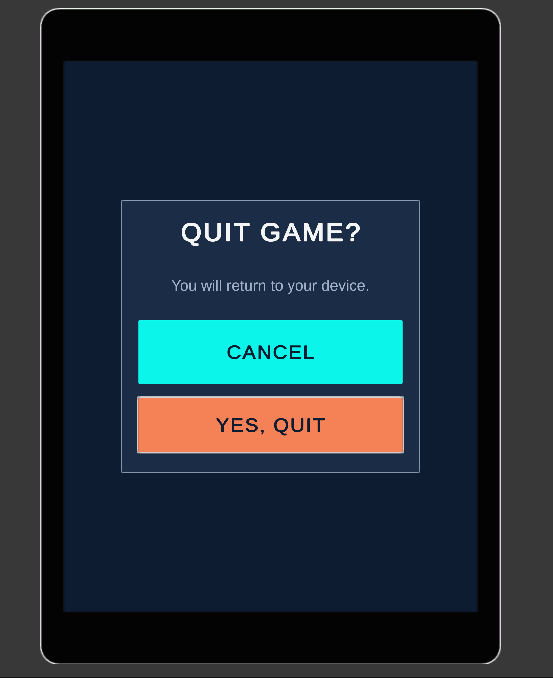

**Greyscale screenshot:**

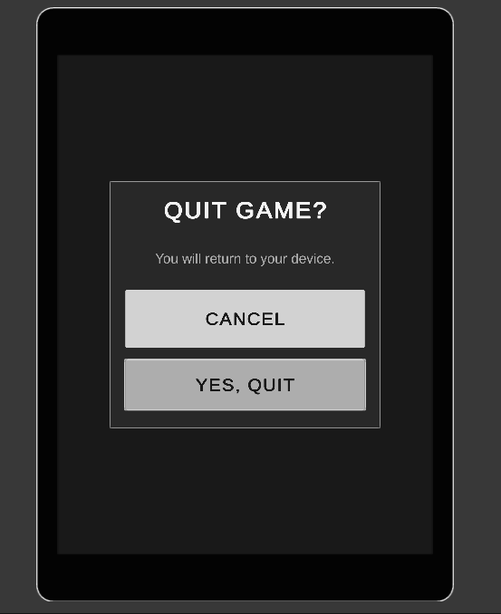

**Greyscale check:** The Prefabs were made in a way of buttons so that their use case like primary, secondary and Danger showcases their HSV demand.

---

## 5. Credits and references
- Genre / menu inspiration: **Jetpack Joyride** by Halfbrick Studios (inspiration only; no assets, colours or images used).
- Fonts / sprites: Unity built-in defaults (TextMeshPro Liberation Sans, default UI sprites "Knob" and "UISprite").
- All scripts, layouts and colours: written by me.
